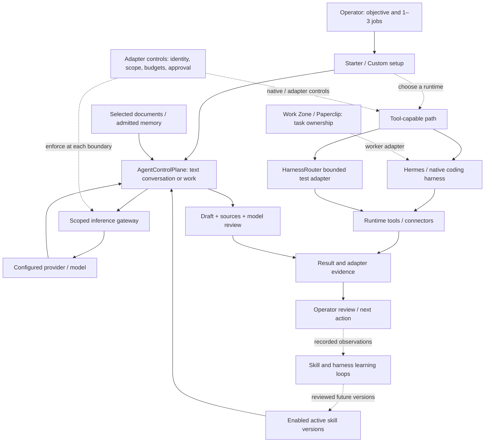
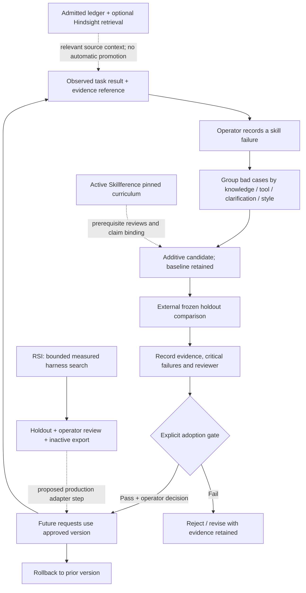

# QuantaCore composable agent systems map

Source review: October 17, 2026. This map describes the current local working tree, including ongoing uncommitted work. It is a design and source inventory; no model request, service activation, training job or financial action was performed to produce it. The accompanying [interactive map](../design/agentic-systems-map.html) contains a connected task-flow diagram, three distinct feedback paths, and a selectable inventory of component purpose, inputs, outputs, value and boundaries. Dashed diagram handoffs label proposed automatic joining or production adoption; current operator-triggered review paths do not establish an unattended learning pipeline.

The organizing principle is simple: a model generates a response; a harness decides how to turn that response into work; a tool performs a specific operation; policy limits authority; evidence shows what actually happened. Memory supplies context across tasks. Evaluation decides whether a proposed change deserves adoption. These are separate responsibilities even when one screen brings them together.

## A small setup that can grow

Start with one agent, one configured model and two or three jobs. Add a module when a task needs its capability. Starter and Custom use the same saved setup; changing the visible module list does not connect a service or grant a permission. [Setup contract](STARTER_CUSTOM_SETUP.md), [module catalog](../lib/system-setup.ts).

| User need | Smallest useful composition | Added value | Proof before expanding |
| --- | --- | --- | --- |
| Answer, draft and review | Starter → AgentControlPlane → configured inference route | One place for focused jobs and reviewable text | A real completed response on the displayed route |
| Use selected documents | Above + Data Intake / Notebook | Explicit source selection and provenance | Confirm assignments and the source text actually included |
| Remember across tasks | Above + governed source ledger; optional Hindsight index | Relevant prior context with private / reviewed master scopes | Scoped admit → recall → correction / deletion round trip |
| Change code or use tools | Hermes or a native coding harness | Runtime tools, streaming and native approval handling | One bounded task, observed tool events, approval and cancellation |
| Coordinate a team | Work Zone / Paperclip + separately configured worker adapters | Task ownership, handoffs, budgets and delivery review | Completed task evidence for the chosen adapter |
| Improve skills or harness behavior | Skills & growth and/or RSI Lab | Versioned, reviewable changes based on observed cases | Frozen comparison, unseen evidence, explicit adoption and rollback |

## Operating flow

Solid arrows show a source-wired relationship. Dashed arrows show an optional module handoff, an operator decision, or a downstream proposal; they do not imply an automatic universal router. Governance is applied by each adapter. The current code does not contain one policy engine that governs every external runtime.

The direct text path does not execute terminal, editing or browser tools. Its Work mode calls the selected model for plan, draft and review. A review by the same model is useful critique but does not establish independent empirical validity. The model/provider and skill versions are frozen for that request. [Actual request path](../components/AgentControlPlane.tsx), especially the `ask` helper and Work stages around lines 187–237.

## Components, differences and value

**Source-wired** means code exists and was inspected. **Separate runtime** means its deployment, account and successful task require their own evidence. **Local review** means an operator records evidence; the screen does not produce or certify it. **Prototype** and **proposed** describe explicit limits. Value below is architectural rationale, not a measured improvement claim.

| Layer / component | Inputs → outputs | Distinction and value | Current boundary / evidence |
| --- | --- | --- | --- |
| **Starter / Custom** | Jobs, model identity, module choices → saved setup and shortcuts | Low initial complexity; the same configuration can reveal more capability later | Source-wired browser configuration. Module choice is navigation, not authorization. [Catalog](../lib/system-setup.ts), [launchpad](../components/SystemLaunchpad.tsx) |
| **Provider connections / inference** | Saved provider endpoint, credential, model and messages → completed text / usage | Chooses the intelligence destination; it does not supply a tool runtime | Source-wired local and hosted adapters. A saved route needs a successful response. Native subscription sign-in is separate. [Inference service](../services/inferenceService.ts), [router](../server/inference-router.ts), [native sign-in](../server/native-sign-in.ts) |
| **AgentControlPlane** | Task, selected sources, optional admitted memory and skills → conversation or plan / draft / review | Simple workspace for users with a few jobs; preserves task/model/skill snapshots | Source-wired text path; no execution tools. Same-model critique is not independent validation. [Component](../components/AgentControlPlane.tsx), [thread contract](../lib/control-plane.ts) |
| **Scoped gateway policy** | Explicit route approval and limits → admitted request / rejection and persisted usage reservation | Constrains a client before inference; route, endpoint and credential changes invalidate scope | Source-wired route pin, byte/output/rate/call/concurrency and spending reservation checks. Local UI is text; explicitly approved external agent profiles may stream/tool-call. Reservation is not vendor billing. [Policy](../server/gateway-policy.ts) |
| **HarnessRouter** | Prompt + chosen harness and model → Responses result with requested/served identity | Composes an engine/tool policy separately from the model, exposing fallback identity | Source-wired bounded test adapter to a separate runtime. Live catalog tool names must fit the selected read-only/research profile. Reported tool names are a contract, not OS isolation. [Adapter](../server/harness-router.ts), [classifier](../lib/capability-profiles.ts) |
| **Hermes workspace** | Scoped Work / Personal session, message, attachment, approval response → streamed content, tool activity and saved session | Full tool-capable session runtime with native approvals and restart handling | Separate installed runtime. Profiles isolate context; they are not filesystem sandboxes. Provider credentials stay in Hermes; adapter transcript files are not encrypted by it. [Manager](../server/hermes-manager.ts), [workspace guide](HERMES_WORKSPACES.md) |
| **Native coding harnesses** | Workspace, purpose, installed client and native login → PTY session, output and exit status | Codex, Claude, Gemini, Goose and Grok use their own coding loops and account rules | Source-wired launchers; clients have different approval/sandbox controls. Codex gets workspace-write/on-request, Claude default permission mode, Gemini default approval. These are not identical confinement guarantees. [Launcher](../server/coding-agents.ts) |
| **MCP / Zo discovery** | Domain-specific credential → bounded catalog of tool contracts | Standardizes tool discovery; exposes the operations an adapter could later authorize | Zo connector sets `agentExecutionEnabled: false`; no general execute endpoint. Muninn client assumes localhost:3001 and a `query_memory` tool, so it remains a scaffold until proven. [Zo adapter](../server/zo-mcp-router.ts), [Muninn client](../services/mcpClient.ts) |
| **Work Zone / Paperclip** | Organization, worker, task and scoped adapter → heartbeat / delivery evidence / human review | Assigns accountability and work ownership across agents; does not replace a model or harness | Separate Paperclip runtime/account. First built-in verification path performs local HTTP checks with zero inference; team role planning is a draft. [Router](../server/workzone-router.ts), [contract](../lib/workzone-contract.ts), [setup guide](STARTER_CUSTOM_SETUP.md) |
| **Data Intake / Notebook** | Imported source, original/hash, mapping and agent assignment → explicitly selected context | Keeps source custody visible and avoids silently giving every agent every dataset | Source-wired browser IndexedDB / Notebook storage. Assignment does not imply embedding, server backup or Hindsight ingestion. [Intake](../services/dataIntake.ts), [source selection](../components/AgentControlPlane.tsx) |
| **Obsidian** | Canonical local notes with explicit ingestion scope → optional indexed copies | Gives the operator an editable canonical knowledge source | Existing report documents one approved note retained/recalled on Oct 13; continuous sync is stopped. This map did not rerun that pilot. No broad watcher or automatic agent sharing is implied. [Pilot evidence report](Obsidian_Sync_2026-10-13.md) |
| **Governed memory ledger** | Screened turn or reviewed source + owner/bank policy → records, provenance, lineage and audit events | Canonical admission, private vs reviewed master sharing, correction and deletion remain inspectable | Source-wired SQLite locally / separate hosted path. Unreviewed conversation stays labeled; recall excludes deleted/stale lineage. [Governance](../supabase/functions/_shared/memory-governance.ts), [local store](../server/memory-store.ts), [target](../lib/memory-target.ts) |
| **Hindsight index** | Explicitly admitted source chunks and query → candidate source IDs for ledger-ranked recall | Improves context retrieval across tasks without changing model weights | Optional projection, default off in bank policy. Adapter enforces chunks, disables observations/auto-consolidation and graph/temporal retrieval. Neural Core illustration shows broader concepts than this adapter activates. [Index adapter](../supabase/functions/_shared/memory-indexes.ts), [governance recall](../supabase/functions/_shared/memory-governance.ts) |
| **Honcho archive** | Explicitly allowed source record → isolated processing-disabled session copy | Optional archive continuity separated from canonical source custody | Optional projection, default off. Reasoning, dreams, summaries, peer cards and peer observation are disabled and checked. It does not supply learned profile conclusions in this governed path. [Archive adapter](../supabase/functions/_shared/memory-indexes.ts) |
| **SkillForge growth** | Observed bad cases, active baseline and additive refinement → candidate, recorded evaluation, adoption / rollback journal | Makes procedural improvement explicit, versioned and reversible | Local review workflow; external frozen comparison is operator-recorded. It does not run SkillForge's autonomous optimizer. No auto-adoption. [Growth logic](../lib/skill-growth.ts), [implementation guide](SKILL_GROWTH.md) |
| **Active Skillference** | Pinned real curriculum and claim ledger + prerequisite reviews → source-bound skill context | Structures learning prerequisites and claim provenance alongside skill selection | Actual project artifacts are checksum-verified locally; reviews do not establish mastery or live SkillTree scores. Keyword matching is not an Active Inference planner. [Parser/pin](../lib/active-skillference.ts), [loader](../services/skillGrowthService.ts) |
| **RSI / RRSI harness lab** | Frozen models, bounded experiment, JSON harness and measured task suite → candidate trees, final holdout and inactive export | Searches prompt/context/tool-policy instructions with an inspectable experiment journal | Models remain frozen; no deployed weight RL. Recorded-tree replay needs three independent completed worlds. Approval/export does not install into live agents. [Controller](../server/rsi-manager.ts), [lab scope](RSI_LAB.md), [harness](../rsi/harness.json) |
| **Research / TradingAgents** | Approved research configuration, data scope and frozen model routes → event journal, analyst reports and research output | Dedicated multi-stage research with preflight and budgeted calls | Separate worker; health is not a completed research task. Research output does not authorize trading. Diagnose persisted failure evidence before retry. [Manager](../server/research-manager.ts), [journal API](../server/research-router.ts) |
| **Firecrawl Alexandria** | Discovery → inspected capability/schema/price → explicitly acknowledged retrieval | Adds specialist external data with contract and credit review | Source-wired local connector; no retrieval follows discovery automatically. Per-record charging stays blocked without an enforceable total cap. External service/account still required. [Router](../server/firecrawl-alexandria-router.ts) |
| **TinyFish** | Search query or approved URL → normalized search results / fetched content | Supplies external research evidence rather than agent memory or orchestration | Source-wired local-server proxy with separate credential and URL controls; no response claim is a completed integration run. [Router](../server/tinyfish-router.ts) |
| **Lost Asset workspace** | Local CSV/archive/workbooks → DuckDB search, prepared cases and local drafts | Domain evidence workspace preserves source records and case lineage | Source-wired local tool path. External scraping, cloud reasoning and agent execution require separate configuration. [Router](../server/lost-assets-router.ts), [store](../server/lost-assets-store.ts) |
| **Cloudroom** | Local GUI + separate core URL/token/account → independent local/cloud sessions | Moves where a tool-capable harness runs while keeping session operations in its own runtime | Quanta stores encrypted core token and checks status. Its bridge is not the cloud executor or a shared global policy engine. Current connection/task success was not probed here. [Router](../server/cloudroom-router.ts), [guide](CLOUDROOM.md) |
| **Hybrid Cloud / Zo / Abacus / Fireworks** | Local job draft, exact payload/export approval, spend reservation → remote job/result and optional evaluated SFT registry | Separates remote reporting/forecasting/SFT from local request routing and records promotion/rollback | Source-wired approval lifecycle; provider credentials, entitlement and completed jobs require evidence. Fireworks SFT is a separate potential weight-training path, not skill learning or RL. Evaluation numbers are recorded evidence. [Manager](../server/hybrid-manager.ts), [router](../server/hybrid-router.ts) |
| **OpenMuse / OpenDots / Clip Studio / OpenHands** | Separate accounts, worker/media configurations → specialist artifacts or runtime sessions | Adds media, computers or specialist runtimes only for users who need them | Setup surfaces point to separate installations; not part of Starter's text loop. Verify the selected adapter/task independently. [System guide](../components/SystemGuide.tsx), [coding runtime docs](HERMES_WORKSPACES.md) |
| **QS Terminal boundary** | Manual read-only service inspection → exact endpoint/schema pin → bounded inventory | Separates source inspection from authoritative QS risk, approvals, orders and fills | Read-only Quanta adapter is prepared; QS is disconnected and no endpoint is pinned. Inventory always abstains without executable opposite-side books and settlement provenance. Full research-proposal handoff remains proposed. [Read-only scope](QS_READ_ONLY_BRIDGE.md), [wider proposal](QS_BRIDGE_PROPOSAL.md) |
| **Readiness and evidence** | Named use case, configuration binding and evidence reference → four visible readiness stages; adapter metadata → local journal view | Separates configured, responding, completed and reviewed; connects captured local requests while preserving native journals | Implemented local metadata contract, manual export and read-only journal projection. Legacy associations are labeled derived. AgenticOS now shows workflow evidence, IronClaw observed access decisions and EdgeMech measured adapter HTTP durations. Preserved design previews remain simulated. No WASM or deployed Redis/worker attestation is claimed. [Panel](../components/RuntimeEvidencePanel.tsx), [contract](../lib/operating-contract.ts), [custody and coverage](OPERATING_EVIDENCE.md) |
| **Composability Copilot** | Four short questions → proposed Starter or Custom composition → model connection review | Helps less technical clients choose two or three jobs and understand each optional part | Guided local interview with transparent composition rules. Applying a reviewed proposal updates the setup draft; model choice and module permissions remain explicit. [Interview](COMPOSABILITY_COPILOT.md), [rules](../lib/composability-copilot.ts) |
| **Reviewed Starter pilot** | Frozen paired benchmark, exact instruction artifact, local model and explicit review → one bounded text-only pilot request | Provides a narrow release and rollback boundary for measured skill/harness instructions | Adapter is implemented; no release is active and no model benchmark has run. Imported scores cannot authorize release. It does not activate RRSI exports or other agents. [Production adapter](../server/production-adapter.ts), [runner](../scripts/evaluate-starter.ts) |

## Security and transparency belong at the boundary

| Boundary | Current enforceable control | What the control does not establish |
| --- | --- | --- |
| Browser → local APIs | Loopback, Host, Origin and `X-Quanta-Client` checks in inference, memory, Hermes and other local adapters | A local UI header is not a multi-user identity service; an already compromised local operator remains powerful |
| Credential custody | `ProviderStore` encrypts saved provider/cloud/OAuth credentials using Windows DPAPI; metadata reads omit plaintext credentials | Not every external runtime's transcript or token file is covered by that store. [Credential store](../server/provider-store.ts) |
| Inference admission | Route/endpoint/key pinning, explicit cloud export/reservation approval and client quotas | Does not authorize a connector or guarantee the provider invoice. [Gateway checks](../server/gateway-policy.ts) |
| Tool exposure | HarnessRouter rechecks catalog and rejects unknown/side-effecting tool names under read-only/research profiles; Hermes/native clients use their own approval mechanisms | Model instructions alone are not permission enforcement; tool names do not prove a hostile implementation harmless. [Profile checks](../lib/capability-profiles.ts) |
| Source and memory ingestion | Explicit source assignment, record provenance, credential/PII pattern screening, private/master policy, tombstones and provider purge state | Pattern matching is incomplete sensitive-data detection; returned text remains untrusted data. [Memory defense](../supabase/functions/_shared/memory-defense.ts), [governance](../supabase/functions/_shared/memory-governance.ts) |
| Growth and adoption | Skill baseline/candidate freezing, disjoint development/holdout IDs, critical-failure gate, operator note and rollback; RSI has frozen config and inactive export | Recorded counts are operator assertions; screening is not a statistical guarantee or universal authorization. [Skills](../lib/skill-growth.ts), [RSI](../server/rsi-manager.ts) |
| Cloud action | Exact draft, domain-separated credentials, explicit payload/spend approval, idempotency and uncertain-state handling | Approval in Hybrid Cloud does not approve Cloudroom, a native harness or financial action. [Hybrid lifecycle](../server/hybrid-manager.ts) |

Transparency means showing the selected and served route, enabled tool scope, relevant sources, applied skill versions, observed tool events, usage/reservations, errors and promotion evidence. It does not require or imply exposing hidden model reasoning. The local evidence view now joins bounded metadata projections and captured HTTP correlation IDs, with manual export. Native journals remain canonical; full native/provider tracing and journal chain verification are not established. Prototype metrics retain their labels.

## Learning loops: what changes, and who decides

| Mechanism | Changes | Current implementation | Interpretation |
| --- | --- | --- | --- |
| Context retrieval | Which admitted sources appear in a future request | Governed ledger; optional Hindsight source index and Honcho archive | Memory use, with frozen model weights |
| Skill adaptation | Versioned procedural instructions | SkillForge-inspired local HNTL failure/candidate/evaluation/adoption loop | Procedure learning by reviewed revision; autonomous optimizer is absent |
| Learning curriculum | Local prerequisite review records and bound claim context | Real pinned Active Skillference artifact | Curriculum support, not certified mastery or live SkillTree scoring |
| Harness adaptation | `harness.json` prompts, context ordering/limits and tool-policy instructions | RRSI experimental search plus bounded recorded-tree replay | Lab search with measured feedback; no deployed weight RL |
| Model training | Provider model weights / tuned artifact | Separate Hybrid Cloud Fireworks SFT job lifecycle | Potential supervised training; no completed training or RL result established by this map |
| Reviewed pilot release | Exact instruction artifact used by an explicit Starter pilot request | Shared evidence package, fixed six-case runner and reviewed local text-only adapter | Implementation exists; no model benchmark or release activation has occurred. Automatic routing, learned traffic selection and broader runtime deployment remain outside this scope |

Hindsight can make an earlier, admitted observation available as context. It does not make a failed run a correct lesson, create a reward signal, run the SkillForge optimizer or alter a harness by itself. The currently wired skill-feedback path captures skill/version IDs and asks the operator for failure/evidence details; it does not automatically move task text, memory or telemetry into a training set. [Feedback integration](../components/AgentControlPlane.tsx), [growth workflow](SKILL_GROWTH.md).

The common learning unit is now a versioned evidence package: correlation, artifact versions/hashes, route and harness identity, result/critical failures, cost/latency provenance, runner/rubric revision and development/holdout split. Recorded assertions, actual benchmark receipts and ungraded production observations retain different labels. Unknown metrics remain unknown. The local journal stores package receipts and separate release decisions; this does not consolidate every native runtime into one authoritative ledger. [Contract and limits](OPERATING_EVIDENCE.md).

## Implemented increment and remaining evaluation

1. **Implemented:** the module catalog keeps configured → responding → bounded task completed → reviewed visible, scoped to a named use case, saved configuration and expiry. Operator assertions are labeled; missing evidence remains unknown.
2. **Implemented:** local correlation/span metadata, native journal links and a read-only evidence page. Custody is local filesystem, export is manual and no collector is enabled. Native/external process tracing remains partial.
3. **Implemented:** shared skill/harness packages and an explicitly reviewed, text-only local Starter pilot adapter. Imported scores cannot mint executed receipts. Benchmark performance and demonstrated production improvement remain distinct. No release is active.
4. **Prepared, not executed:** a fixed six-case unseen-instance runner. The local model is unavailable; the operator requested a [separate cloud model and budget scope](STARTER_CLOUD_EVALUATION_SCOPE.md). That proposal allows at most twelve calls, 512 output tokens each, six minutes and a proposed US$1 cap after billing controls and explicit execution approval. No model requests or spend occurred. Automatic routing and learned selection remain unimplemented.

The map is a composition guide. Live readiness still requires scoped evidence from the selected runtime. Broader automation, service activation, paid experiments and architecture changes require their own concrete scope.
