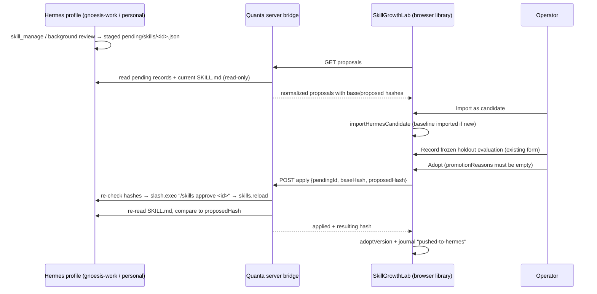

# Hermes skill bridge (design)

Status: **read-only reader, library import and proposal-review UI implemented locally; Hermes write-back remains proposed.** Written October 17, 2026 against the installed Hermes agent under `%LOCALAPPDATA%/hermes/hermes-agent` and the current SkillGrowthLab code. The integration reads pending files and imports an explicitly reviewed candidate into the operator's browser library. It does not apply, reject or roll back a Hermes file.

## Goal

Hermes already writes its own skills: the `skill_manage` tool and its background review fork create, rewrite and patch `SKILL.md` files. SkillGrowthLab already has the SkillForge evaluation gate (frozen baseline/candidate comparison, at least five distinct holdout cases that don't overlap the development cases, zero critical failures, operator note, rollback). The bridge joins them:

1. A skill edit Hermes proposes becomes a **SkillGrowthLab candidate** instead of being applied.
2. Only a candidate that passes the gate and gets an explicit operator decision is **written back to the Hermes profile**.
3. Rejections and rollbacks in the lab are reflected in Hermes too.

Nothing in this loop runs unattended. The bridge moves proposals and verified results; the decisions stay with the operator.

## Facts this design relies on

| Fact | Source |
| --- | --- |
| With `skills.write_approval: true`, every skill write (foreground or background review) is staged instead of applied. | `tools/write_approval.py` `evaluate_gate` |
| Staged writes are JSON files at `<HERMES_HOME>/pending/skills/<id>.json` with `id`, `action`, `summary`, `origin` (`foreground` / `background_review`), `created_at` and the exact `payload` to replay. | `write_approval.py` `stage_write` |
| Payload actions: `create`, `edit` (full SKILL.md), `patch` (`old_string` → `new_string`), `write_file`, `remove_file`, `delete`. | `write_approval.py` `skill_gist`, `skill_pending_diff` |
| `/skills approve <id>` replays the payload through `apply_skill_pending` (Hermes' own guards) and removes the record. `/skills reject <id>` only removes the record. | `hermes_cli/write_approval_commands.py` |
| The gateway QuantaCore already uses exposes `slash.exec {session_id, command, profile}` and `skills.reload {session_id}`. | `apps/shared/src/gateway-contract.openrpc.json` |
| `skills.write_approval: true` is set in `gnoesis-work` and `gnoesis-personal` (Oct 17). Running gateway sessions pick it up after a Hermes restart. | profile `config.yaml` |
| The skill library lives in **browser localStorage** (`quanta_skill_growth_v1_<owner>`). The server cannot read or change it. | `services/skillGrowthService.ts` |
| `proposeVersion` builds candidates only by **appending** a refinement to an active parent, and needs recorded failure cases. Content is capped at 12,000 chars; the library at 32 versions. | `lib/skill-growth.ts` |

The last two facts shape the design: the server handles the Hermes side and the browser owns the library, and Hermes proposals (full rewrites with no recorded failure cases) need their own import path.

## Flow

### 1. List proposals (server, read-only)

`GET /api/hermes/:workspace/skill-proposals`

- Resolves the profile from the workspace (`work` → `gnoesis-work`, `personal` → `gnoesis-personal`) and reads `<HERMES_HOME>/profiles/<profile>/pending/skills/*.json`.
- For each record, finds the current skill directory under `<profile>/skills/**/<name>/SKILL.md` (path containment check, no symlinks) and returns:
  - `pendingId`, `action`, `origin`, `createdAt`, `summary`, `skillName`
  - `baseText` + `baseHash` (SHA-256 of the current SKILL.md, empty for `create`)
  - `proposedText` + `proposedHash`: `create`/`edit` use `payload.content`; `patch` applies `old_string` → `new_string` to `baseText` only if `old_string` occurs exactly once
  - `importable: false` with a reason for: `write_file`, `remove_file`, `delete`, any path outside `SKILL.md` (SkillForge's no-scripts constraint, §2.2), patches that don't match exactly once, and text over 12,000 chars. These stay reviewable in Hermes with `/skills diff <id>`.
- Pending payloads and skill text are **untrusted data**. The UI shows them as plain text or diffs, never as rendered HTML, and never follows instructions inside them.

### 2. Import as candidate (browser)

New `importHermesCandidate(state, proposal, note)` in `lib/skill-growth.ts`:

- Library skill ID is `hermes:<workspace>:<skillName>`, so a Hermes copy never collides with the lab's own seeded skills.
- If that skill has no active version yet, first add `baseText` as the **active baseline** (journal `baseline-imported`, origin `hermes`, `contentHash = baseHash`). For a `create` proposal, the baseline is an empty placeholder version, so the gate compares the new skill against having no skill.
- Adds the candidate with the full `proposedText` (not appended), `parentId` = that baseline, and an `origin` block: `{ kind: 'hermes', workspace, skillName, pendingId, baseHash, contentHash }`.
- `caseIds` may be empty: the development evidence is the Hermes review session, recorded in the journal note. The holdout gate still applies in full.
- Refuses the import if the library's active baseline hash differs from `baseHash`, meaning the Hermes file changed since the lab last saw it.

`SkillVersion` gets one optional field, `origin?`. `validateLibrary` accepts it, so `version: 1` libraries keep loading.

**Additivity.** SkillForge's optimizer only adds content; Hermes rewrites can delete. `promotionReasons` gets one extra rule for `hermes` candidates: if the candidate removes baseline lines, adoption also needs a confirmation checkbox stating that the removals were reviewed (recorded in the adoption note). This keeps "never delete working content" visible without blocking legitimate cleanups.

### 3. Evaluate and adopt (existing gate)

Unchanged: `recordEvaluation` freezes both texts, and `promotionReasons` requires ≥5 distinct holdout IDs, no overlap, improvement, zero critical failures, unchanged frozen text and an active baseline.

**Order matters.** The Adopt button does: `promotionReasons` empty → **push to Hermes** → on success only, `adoptVersion` + journal `pushed-to-hermes <hash>`. If the push fails, the library is unchanged, and the operator sees the reason.

### 4. Apply (server)

`POST /api/hermes/:workspace/skill-proposals/:pendingId/apply` with `{ baseHash, proposedHash }`

1. Re-read the pending record and current SKILL.md. Return `409` if the record is gone, its payload hash changed, or the current file hash isn't `baseHash`.
2. Call `slash.exec { session_id: <bridge session>, profile, command: "/skills approve <pendingId>" }`. Applying through Hermes keeps its own guards (pinned skills, org mirrors, linter, opt-in security scan) and removes the pending record.
3. Call `skills.reload { session_id }`.
4. Re-read SKILL.md and require `sha256 == proposedHash`. Hermes may apply a `patch` with matching rules that differ from the bridge's preview. On a mismatch, return `502` with the actual hash and text. The lab then records the failure and doesn't adopt, and the operator can roll back in Hermes or import the actual text as a new candidate.

**Bridge session.** `slash.exec` needs a session ID. `HermesManager` gets a dedicated per-workspace control session (`gnoesis-<ws>` profile), created on first use and hidden from the conversation list. It never receives model turns. If the gateway isn't running, apply returns `503` and nothing changes.

### 5. Reject

Rejecting a `hermes` candidate in the lab calls `POST .../:pendingId/reject` → `slash.exec "/skills reject <id>"`, then `rejectVersion`. Rejected evidence stays in the library journal.

Proposals the operator never imports simply stay pending in Hermes. The lab shows the count so they don't pile up unseen.

### 6. Rollback and lab-authored versions

These have no Hermes pending record, so they use a direct write:

`POST /api/hermes/:workspace/skills/:skillName/write` with `{ baseHash, text, contentHash, reason }`

- Only for skills the library has imported (`hermes:` prefix), only `SKILL.md`, only after the same base-hash check.
- Copies the current file to `.quanta/hermes/skill-backups/<profile>/<name>/<timestamp>.md`, writes atomically (temp file + rename), then `skills.reload`, then verifies the hash.
- Used by `rollbackVersion` and by candidates built in the lab with `proposeVersion` on a `hermes:` skill. Same push-then-commit order as adoption.

## Boundaries

- Endpoints sit behind the existing loopback, Host, Origin and `X-Quanta-Client` checks in `hermes-router.ts`. This is local single-operator custody, not multi-user authorization.
- Profiles are limited to `work` and `personal`. Skill paths must resolve inside that profile's `skills/` root.
- The bridge only moves `SKILL.md` text. It never runs skill scripts, never creates `scripts/` files, and never changes `skills.write_approval`.
- Turning `skills.write_approval` off in Hermes bypasses the bridge entirely: Hermes would apply edits directly again. The lab shows the current gate state, read from the profile config, next to the proposal list.
- Recorded evaluation counts remain operator assertions, as today. The bridge adds hash-verified custody of *which text* was evaluated and deployed. It doesn't make the evaluation itself independent.

## Implementation slices

| Slice | Files | Done when |
| --- | --- | --- |
| 1. Read-only proposals | new `server/hermes-skill-bridge.ts`, `server/hermes-router.ts` | Lists real pending records with hashes. Unit tests cover each action type, the patch-once rule, size limits, path containment and malformed JSON |
| 2. Library import | `lib/skill-growth.ts`, `services/skillGrowthService.ts` | `importHermesCandidate`, `origin` validation, removed-lines rule. Old libraries still load |
| 3. Lab panel | `components/SkillGrowthLab.tsx`, new `services/hermesSkillBridge.ts` | Proposals list, plain-text diff, import, gate state, pending count |
| 4. Apply / reject | bridge + `server/hermes-manager.ts` control session | Push-then-adopt order. 409/502/503 paths tested against a fake gateway (pattern: `hermes-manager.test.ts`) |
| 5. Rollback / direct write | bridge | Backup, atomic write, reload, hash verification |
| 6. Live check | — | One real Hermes-proposed edit taken through import → evaluation → apply → verified hash in `gnoesis-work`, recorded with evidence. This must happen before calling the bridge working |

## Current app integration

Open Skills & growth → Growth loop → Review staged skill edits. Choose Work or Personal, manually read pending proposals, inspect the plain-text baseline and proposed content, and supply an import note. Import re-reads the source, requires the configured write-approval setting, verifies both text hashes and refuses stale or ambiguous records. It changes only the browser review library. Imported Hermes versions stay out of Quanta request context. Their local adoption remains blocked until a separately reviewed write-back adapter verifies the deployed artifact. Rejecting a local candidate does not remove its Hermes pending record.

Profile configuration is not proof of the running Hermes process's gate state. This UI does not restart Hermes or change its settings. Recorded holdout counts remain operator assertions; neither reading nor importing executes a model evaluation.

## Remaining design questions

1. **Matching skill IDs between Hermes and the lab.** Should the lab's seeded `skillforge` and the Hermes `autonomous-ai-agents/skillforge` be linked as one skill, or tracked separately? This design keeps them separate (`skillforge` vs `hermes:work:skillforge`).
2. **Pending volume.** If background review stages many proposals, the lab may want filters (by skill or origin) or a "reject all older than N days" action, which would still be operator-triggered.
3. **Limits.** Hermes skills can exceed 12,000 chars and the library caps at 32 versions. Hermes-linked skills may need their own export/archive rhythm.
