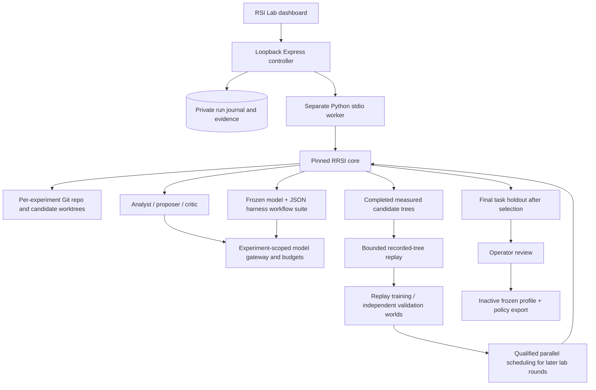

# Quanta RSI Lab

Local agent-harness R&D at `http://127.0.0.1:3000/#/rsi-lab`.

The actual [Google Research RRSI](https://github.com/google-research/rrsi) core is installed in a separate `C:\QuantaRRSI` checkout and Python 3.11 environment. `rsi/upstream.lock.json` pins revision `be50316e1db05914068a973f322770ef08ed7ba1`. The package is Apache-2.0; upstream third-party benchmark components have separate terms and are not bundled into this adapter.

The [Dream-RSI official repository](https://github.com/zhengkid/Dream-RSI) currently marks its full codebase as being prepared. Quanta implements a **recorded-tree replay adaptation**, not official Dream-RSI code or a paper reproduction. It replaces the supplied sketch's random scores with stored measured outcomes. It also removes heldout-weighted candidate selection: a final task holdout never enters search-role context or RRSI selection.

## Setup and operation

```powershell
Set-Location C:\QuantaCore
.\scripts\install-rsi.ps1
npm run dev
```

`uv`, Git and Python 3.11 are required. `RRSI_ROOT` can point to a separate checkout; its `.venv` must contain the package at the approved source revision. The local checkout and `data/rsi/` are excluded from Quanta Git changes. No model credentials are copied to the worker or checkout. Configure an API-compatible route in Quanta Settings, then refresh the lab.

1. Select the frozen policy and search-role routes, seed instructions, round/trial limits and hard call/token/time limits.
2. Review the server-frozen configuration. Approve the exact review to start a run. Source, suite and route changes invalidate approval. No provider requests occur during install, status, review or replay.
3. Follow persisted phase/trial/usage events. Cancellation aborts model calls and stops the worker tree. A restart marks unfinished runs interrupted; it does not restart paid work automatically.
4. Inspect evolve results, candidate/critic evidence and final holdout results. Export the full journal for independent analysis.
5. Review a measured candidate. Approval requires evolve improvement, complete holdout measurements and no aggregate holdout regression. Export a frozen JSON profile and exploration policy. The export is inactive and must be deliberately integrated with a production adapter after broader evaluation.

Optional USD caps use explicitly supplied per-million input/output rate quotes. These are operator estimates, not a vendor billing guarantee. Unknown rate is `null`, not zero; without quotes the hard limits are calls, tokens and time. Admission reserves input bytes plus overhead and the maximum output before requests; missing usage or failed calls retain their conservative reservation. All analyst, digester, proposer, critic and policy calls are metered, including JSON-repair turns.

## Architecture



The first custom `Domain` evolves only `harness.json`: general prompts, response instructions, context ordering/limit, source labels and tool-policy instructions. JSON is parsed as data. Generated Python, shell commands and arbitrary plugins are not executed. The synthetic suite tests evidence arithmetic, source attribution, uncertainty, conflicting records, untrusted source instructions and approval discipline. It has no external tool permissions or financial orders. Six evolve tasks and four holdout tasks share a frozen rubric; its scores do not establish general agent capability or alpha. Repeated use of a small public holdout can overfit; reserve a larger unseen external suite before adoption.

The transport is injected before upstream role modules import `generate`. The RRSI core, annealed edit limits, critic, history, native noise/cost selection and worktree lifecycle remain upstream code. Baseline trials feed native noise calibration; digester and candidate evaluation concurrency obey the operator's cap. A Windows adaptation uses POSIX Git tree paths and bounds cleanup to experiment worktrees. The worker receives an experiment-scoped ephemeral token and a minimal environment, not `.env` or provider keys. Public route lists read only metadata; review decrypts the selected connection. Frozen model connections exist in controller memory, while persisted configuration records hashes and public route names. A single-controller ownership lock prevents a second process from rewriting an active journal.

## Nested replay scope

Recorded trees are generated only from completed candidate evaluations with known token counts. Candidate outcomes are revealed only when a replay policy opens the node. Policies are structured data: breadth/depth traversal, bounded batch width, node cap and stopping gain. No `eval`, random score or invented unseen branch is used.

Three independent completed experiment worlds are required. The earlier worlds train policy choice; the latest world is used once for replay validation against a fixed baseline. Trees from several rounds of one experiment do not count as independent worlds. The pool is bounded to 30 recent experiments with the same frozen suite. Results include world IDs, pool hash, replay utility, node/token cost and support limits. Replay utility is a Quanta design choice, not a paper result.

A qualified batch width can affect the **next** native RRSI round, within the operator's parallel limit. Native RRSI still measures every screened candidate. Traversal/stopping rules are replay previews; this adapter does not skip required evaluations or claim a total search-compute saving. Cold start reports `insufficient_history`; no synthetic history is injected into real runs.

Model weights remain frozen. Dream policy is not a learned world model: it traverses only recorded support. IronClaw and other production harness adoption are downstream adapter work; an approved export does not automatically grant tools or change live agents.

## Validation

The upstream core test suite and Quanta worker/replay/controller tests run without provider calls. Synthetic fixture tests exercise actual RRSI baseline, candidate worktrees, critic/selection wiring, holdout isolation and evidence output. They validate integration mechanics and are kept distinct from measured model experiments. A live model experiment requires the dashboard's explicit frozen review and budget approval.

The installed integration passed 30 offline checks: 8 upstream core, 7 worker/replay, 9 controller/provider and 6 existing inference-route checks. TypeScript checking, the production build and the live pinned-engine readiness probe also passed. Provider authentication and rate-limit failures have distinct persisted error codes. No live model experiment or paid retrieval was started during setup. The existing large-bundle build warning remains.

## Research subpages

The RSI workspace contains three routes, reachable from its shared navigation and dashboard cards:

| Route | Workspace | Purpose |
| --- | --- | --- |
| `/#/rsi-lab` | Harness evolution | Review and run bounded local RRSI experiments, inspect the journal and replay measured worlds. |
| `/#/rsi-lab/intent` | Reference · Intent · Taste | Build a source-grounded mandate with objectives, constraints, acceptance criteria, health metrics, stop rules, decision preferences and approval boundaries. |
| `/#/rsi-lab/systems` | QS Systems Lab | Define system/signal combinations, record evaluator metrics, compare up to four tests, filter results and maintain a testing shortlist. |

The intent workspace is adapted from the supplied `Near.md` research notes. It has agent-harness, trading-research and DeFi-research templates, browser-local draft saving and validated JSON import/export. **Use as starting harness instructions** transfers a complete mandate into the existing reviewed RSI setup; it does not launch a run or change the task evaluator. The prepared instructions remain bounded to 6,000 characters. OpenRouter's free route is preferred as the initial model when configured.

Primary references are linked for [NEAR Intents](https://docs.near-intents.org/), [IronClaw](https://github.com/nearai/ironclaw) and [NEAR AI Agent Market](https://market.near.ai/). These are downstream adapter references. This subpage does not install external runtimes, issue signed intents, hire agents, connect wallets, transfer credentials or publish data. Provider rankings and performance claims from the notes are not copied as verified results.

QS Systems Lab is a native Quanta workspace based on the user-supplied [QS Terminal Systems Lab](https://qs-terminal-systems-lab.brisk-beech-3852.chatgpt.site/#results). It supports the original version-1 `records` JSON export. Imports are validated and previewed before merging; existing records are retained and duplicate IDs receive new IDs. Demo source labels remain synthetic. Missing values remain unknown, and finite/range checks reject invalid metrics. Records are operator assertions, not an audit of the source backtest.

The research gate checks sample size, drawdown, Sharpe, documented execution costs, testing context, evidence and frozen rules. Synthetic demos and unverified records cannot pass. A qualifying phase label is not proof of holdout isolation. Comparison warns when analysis windows, instruments, sizing, costs or ratio conventions differ. Financial metrics never become RRSI agent-task scores. **RRSI evidence** reads the local harness journal without launching work. No backtest engine or order execution is introduced by these pages.

Intent drafts and QS records use separate browser-local storage keys. They are not server-synced, encrypted vault entries, Obsidian memories or shared KB records. Export JSON backups to retain them across browsers/origins. Importing a file is local; external source links open separately and no workspace data is sent to them.

### Subpage verification

The production bundle includes both native pages and the original QS system identifiers. Browser checks confirmed mandate template/save/persistence and explicit handoff into starting instructions; the original QS JSON import preview and merge; an unchanged demo record save; matched comparisons; shortlist and source-preserving JSON export; synthetic-demo exclusion from research gates; and local RSI journal access. The imported reference workspace contains 8 synthetic demos, 0 measured records and 2 shortlist entries. RSI configuration review defaults to the configured free route, and replay correctly reports `insufficient_history` with 0 worlds. No live provider request was made. Visual evidence is saved locally under ignored `data/rsi/`.
